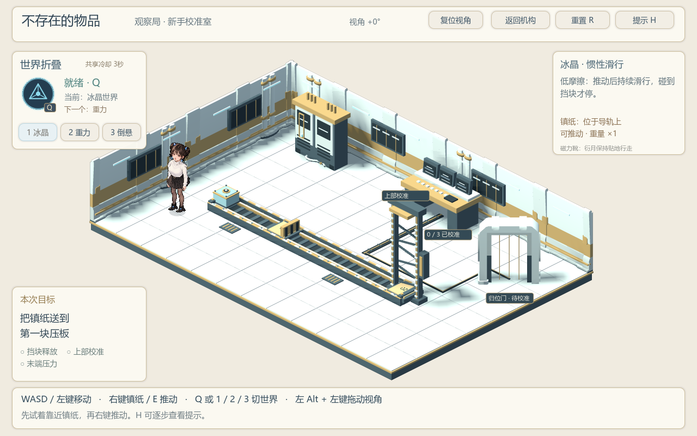
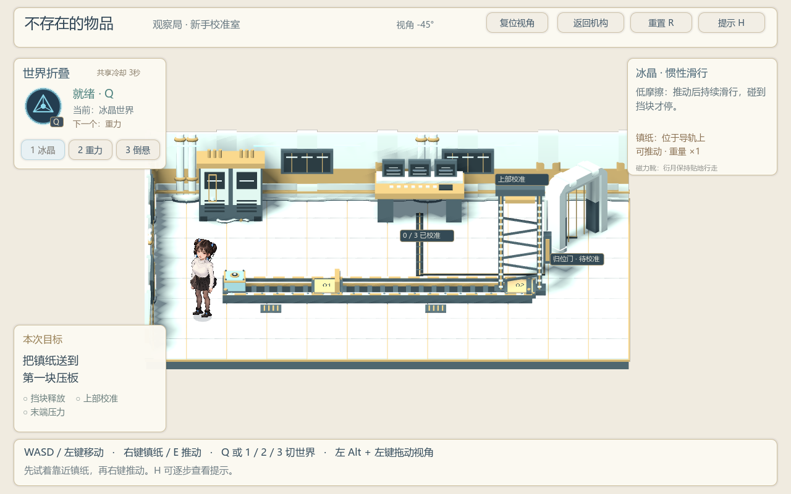
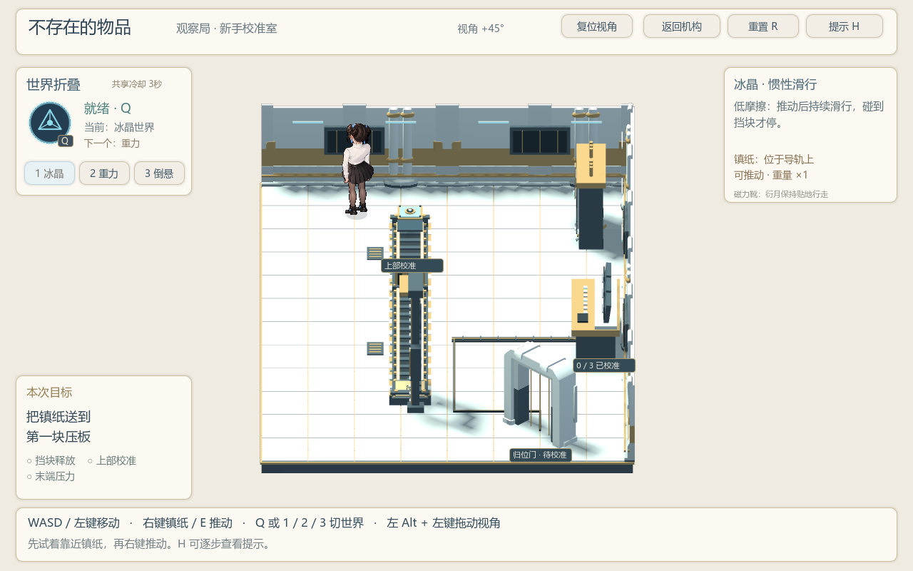

# 不存在的物品 · 衍月的平行世界解谜

一个使用 Godot 制作的黑客松游戏原型：让同一块镇纸在不同平行世界中改变物性，用滑行、重量和反向重力完成机关校准。

当前版本 **v0.4**，包含可完整通关的新手校准室、观察局大厅，以及可左右旋转的场景视角。剧情漫画和正式关卡尚未接入。



## 下载与运行

- **Windows 试玩**：进入[试玩下载页](https://github.com/forey217/nonexistent-items/releases/latest)，下载最新版 `nonexistent-items-v0.4-windows-x86_64.exe`，双击运行。
- **查看源码**：直接浏览下方 `game/` 目录。
- **使用 Godot 编辑**：安装 Godot **4.7.2 标准版**，导入 `game/project.godot`，运行主场景。项目使用 GDScript，无需 .NET。

Windows 版本使用 Compatibility / ANGLE 渲染；当前已在本机 Windows 与 RTX 5060 Laptop 上验证，其他设备尚待试玩。

## 玩法

观察局校准室中，同一块镇纸在三个平行世界里具有不同物性。切换世界保留镇纸的位置和校准记录，玩家需要组合这些物性完成解谜。

| 世界 | 物理规则 | 镇纸用途 |
| --- | --- | --- |
| 冰晶 | 低摩擦、持续滑行 | 推动后沿轨道滑到挡块或末端 |
| 重力 | 向下受力增强，重量 ×4 | 压下校准板，无法徒手推动 |
| 倒悬 | 重力方向向上 | 上浮并触碰高处接收器 |

完成上部校准与末端压力条件后，归位门开启；走入门内即可返回观察局大厅。卡住时可以按 H 逐步查看提示。

<details>
<summary>展开查看完整教程解法（含剧透）</summary>

冰晶推动至第一压板 → 重力释放挡块 → 冰晶再次推动至末端 → 倒悬上浮完成上部校准 → 重力落下并压住末端压板 → 走入归位门。

</details>

## 操作

| 输入 | 功能 |
| --- | --- |
| WASD / 方向键 | 移动；旋转后跟随屏幕方向 |
| 鼠标左键 | 点击地面，自动寻路 |
| 右键镇纸 / E | 推动；远处右键会先靠近再交互 |
| Q / 1、2、3 / 左上技能按钮 | 切换世界，共享 3 秒 CD |
| 左 Alt + 鼠标左键水平拖动 | 绕校准室旋转视角，范围 ±45° |
| 右上“复位视角” | 回到默认视角，保留解谜进度 |
| 右键电源柜 / 监测台 | 查看当前规则或校准状态 |
| H / R / Esc | 逐步提示 / 重置教程 / 取消行走 |
| F2 | 显示碰撞区域 |

角色不能跳跃。接待大厅保留原来的固定视角。

## 旋转视角

| 左侧视角 | 右侧视角 |
| --- | --- |
|  |  |

校准室使用实时正交显示和 2D 人物纸片，碰撞、导航与解谜仍运行在独立的 2D 逻辑层。鼠标位置会随视角换算，界面保持固定。

## 当前完成度

已完成：人物移动与碰撞、点击寻路、三世界规则、新手机关完整流程、世界切换技能与 CD、场景设备反馈、±45° 视角旋转、Windows 导出与返回大厅。

待制作：正式关卡、漫画剧情、开始菜单、音效与美术的进一步完善，以及更多设备上的试玩验证。

## 工程结构

```text
game/
  project.godot             Godot 工程入口
  main.tscn                主场景
  scenes/                  人物与关卡场景
  scripts/                 移动、寻路、机关、UI 与旋转显示
  assets/                  人物分件、模型、图块与素材许可
  tests/                   教程、旋转及移动检查
  tools/                   图块渲染与素材分析脚本
  docs/                    设计、制作过程和美术来源记录
showcase/                  实机截图与检查报告
```

实现说明：[视角旋转](game/docs/视角旋转-v04.md)、[校准室玩法](game/docs/校准室-v01-设计与验收.md)、[世界切换技能](game/docs/世界折叠技能-v02.md)。

## 验证

- 新增旋转检查：17 项，0 失败。
- 教程检查：58 项，0 失败，包含 1,517 次位置采样。
- 人物移动回归：73 项记录，0 失败；其中 1 处历史家具位置检查因相邻家具占地重叠而跳过。
- Windows 导出程序已在原生渲染中完成教程，并成功返回观察局大厅。

报告见 [showcase/checks](showcase/checks)。可在本地执行：

```text
Godot --headless --path game --fixed-fps 60 -- --tutorial-self-test --artifacts=<报告目录>
Godot --headless --path game --fixed-fps 60 -- --orbit-self-test --artifacts=<报告目录>
Godot --headless --path game --fixed-fps 60 -- --self-test --artifacts=<报告目录>
```

## 美术来源与 AI 辅助制作

- 衍月形象参考比赛官方提供的角色设定；人物分件与早期家具图集使用 AI 辅助制作。
- 墙板、线缆与归位门框来自 **Kenney / Modular Space Kit 1.0**，使用 **CC0** 许可。保留了[原始许可](game/assets/kenney_modular_space/License.txt)和[来源清单](game/assets/kenney_modular_space/SOURCE.json)。
- 轨道、镇纸、接收器、电源柜与监测台的几何由项目脚本构建；同一构建器用于离线图块和实时旋转显示。
- 代码实现、迭代与检查通过 Codex 辅助完成，制作记录与图像提示词保存在 `game/docs/`。

第三方许可适用于相应素材，不代表全部角色与美术统一采用 CC0。

项目作者：周书屹。
