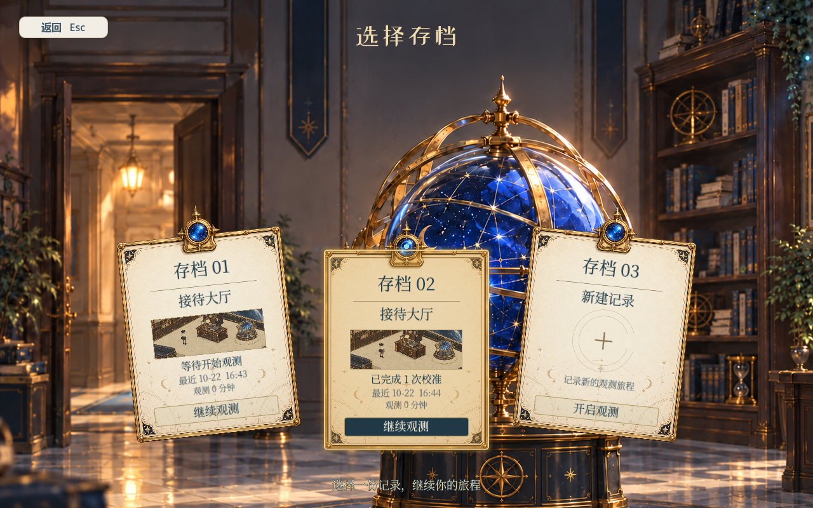
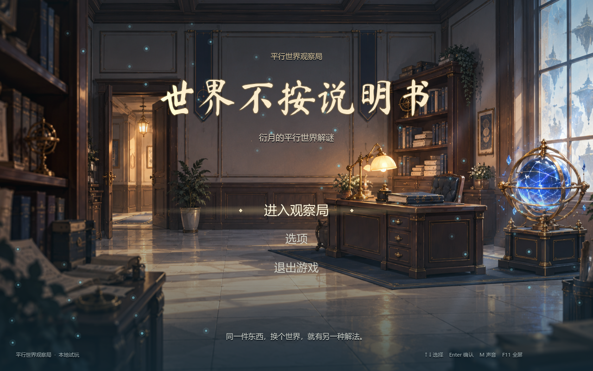
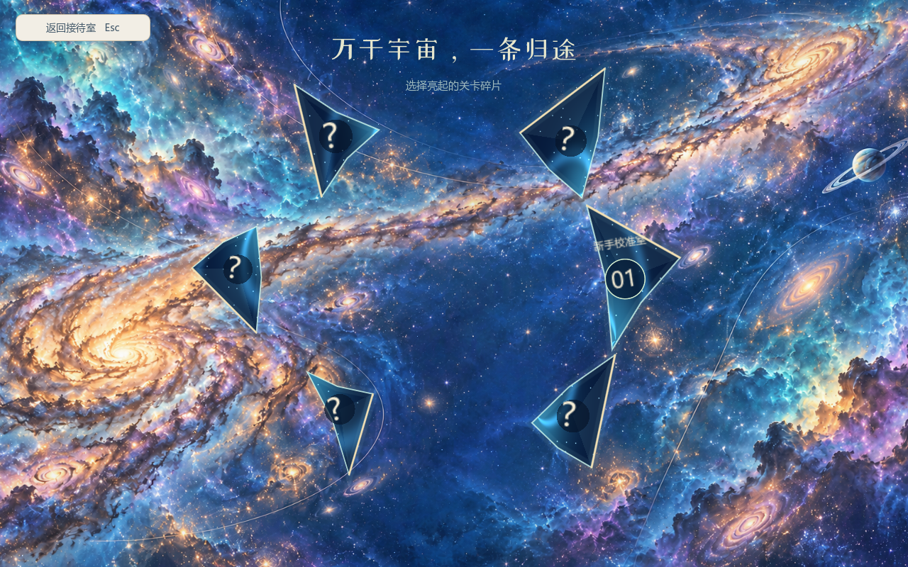
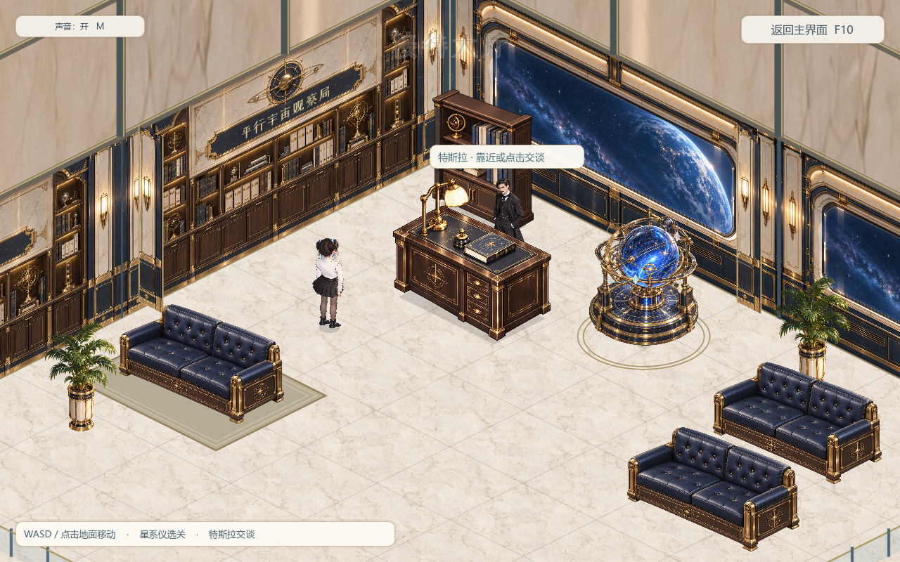
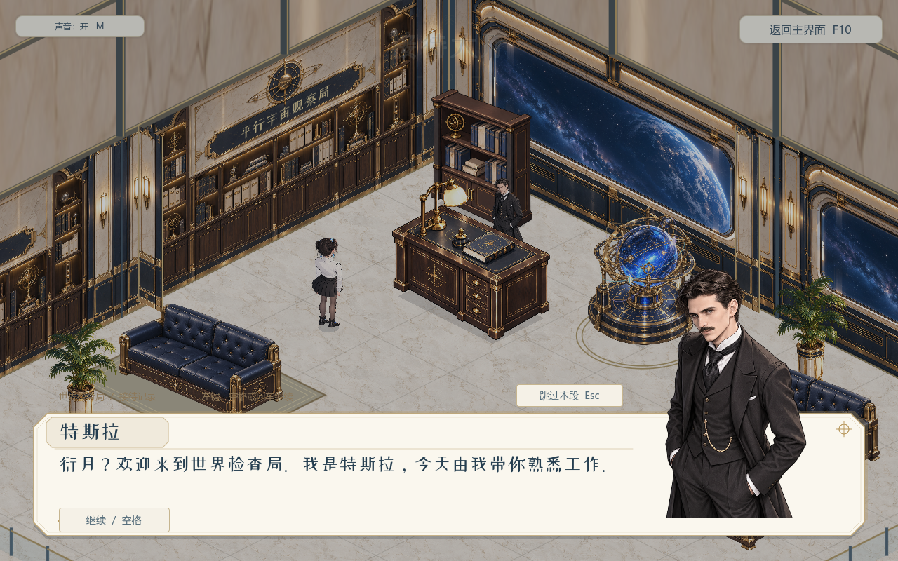
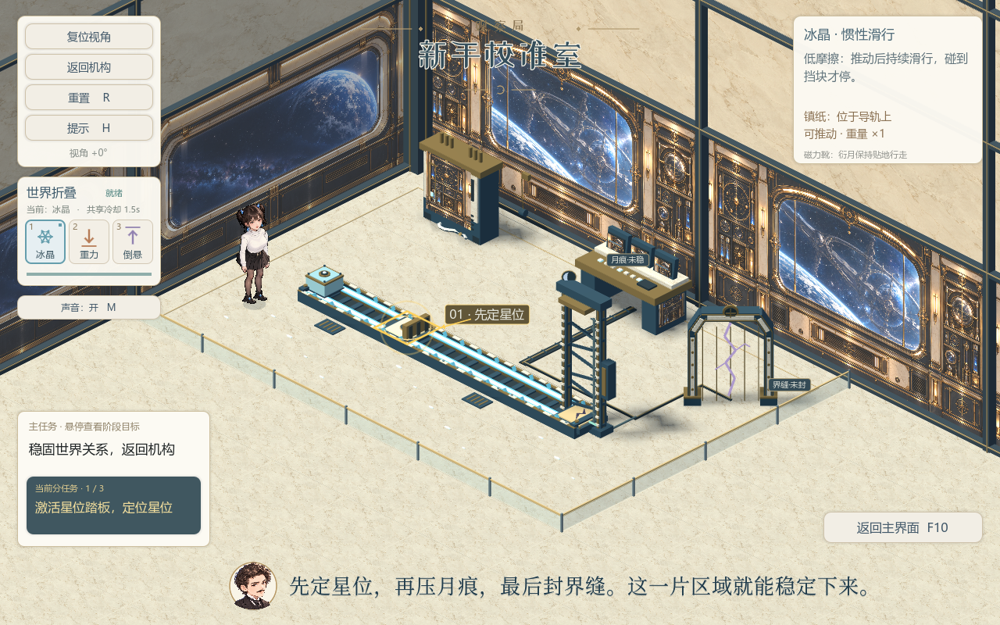

# 世界不按说明书

衍月的平行世界解谜游戏，使用 **Godot 4.7.2 标准版 / GDScript** 制作。同一块镇纸，在冰晶、重力与倒悬世界中拥有不同物性，玩家需要组合规则完成观察局的第一次校准。

当前源码版本 **v0.39**，包含三档本地存档、启动界面、室内接待大厅、星系仪、水晶碎片选关、角色剧情与教学，以及一张可完整通关的新手校准室。游戏原名为《不存在的物品》，仓库地址沿用原名。下方 Windows 发布下载仍为此前的 v0.38.1；本次更新源码。

本次加入三档“扇形档案页”：点击进入观察局，推近星系仪后选择记录，空档开始新游戏，已有档继续最近稳定检查点。各档分别保存剧情、关卡进度、通关次数及游玩时间；返回主界面和正常退出时自动保存，并保留有效备份。保留满构图室内场景、Q版头像字幕、靠近或点击特斯拉交谈、完整解谜与通关归档。第二关目前只有设计文档，尚未接入游戏。







## 下载与运行

- [下载 Windows 试玩版](https://github.com/forey217/nonexistent-items/releases/download/v0.38.1/world-without-manual-v0.38.1-windows-x86_64.exe)：双击运行，无需安装Godot。
- [v0.38.1发布页、源码与许可文件](https://github.com/forey217/nonexistent-items/releases/tag/v0.38.1)。
- [v0.24历史版本与选关动画](https://github.com/forey217/nonexistent-items/releases/tag/v0.24.0)。
- 编辑工程：克隆仓库，使用Godot **4.7.2标准版**导入 [`game/project.godot`](game/project.godot)，运行主场景。无需.NET。

Windows导出使用Compatibility / ANGLE渲染，已在Windows与RTX 5060 Laptop上验证；其他设备尚待试玩。

## 从观察局出发

**进入观察局 → 星系仪推近与三档记录 → 新建进入大厅 / 继续检查点 → 自由探索或与特斯拉交谈 → 点击星系仪 → 水晶分裂选关 → 新手校准室。**

星图最初只有一枚完整水晶，鼠标悬停时细裂缝亮起，点击后向四周分裂为六块关卡碎片。当前只有 **01 / 新手校准室**可进入，其余五块显示问号。

选择01后，其他碎片带拖尾旋转汇入它；镜头跟随选中碎片旋转、放大、亮起，随后衍月从空间裂隙中走进关卡。通关后，校准室缩成档案卡，盖章后沿抛物线归档，再返回接待大厅。

| 接待大厅 | 剧情对话 |
| --- | --- |
|  |  |



## 玩法与操作

| 世界 | 物理规则 | 镇纸特性 |
| --- | --- | --- |
| 冰晶 | 低摩擦 | 推动后持续滑行，碰到挡板才停 |
| 重力 | 向下受力增强 | 重量×4，可压动机关 |
| 倒悬 | 重力方向向上 | 向上漂浮，触碰高处机关 |

切换世界保留镇纸位置和机关记录。组合物性完成星位、月痕与界缝校准，归位门就会开启。任务只展示阶段目标，具体解法可按H逐步查看。

| 输入 | 功能 |
| --- | --- |
| WASD / 方向键 | 人物移动 |
| 鼠标左键 | 点击地面寻路；点击星系仪和关卡水晶 |
| 右键镇纸 / E | 互动镇纸，轨道两侧均可就近操作 |
| 1 / 2 / 3 | 切换世界，共享冷却 **1.5秒** |
| 左Alt + 左键水平拖动 | 旋转校准室视角，范围±45° |
| H / R | 逐步提示 / 重置校准室 |
| M / F11 | 静音 / 切换全屏 |
| F10 | 从正常玩法或大厅返回启动界面 |
| Esc | 关闭手册、退出未进入的选关界面，或取消行走 |

角色不能跳跃。选关和归档等切场景动画不会被重复点击或F10打断。

<details>
<summary>完整教程解法（含剧透）</summary>

冰晶推动至第一踏板 → 重力压下踏板并释放挡板 → 冰晶推动至末端 → 倒悬上浮完成月痕压印 → 重力落下压住末端踏板、封合界缝 → 走入归位门。

</details>

## 当前完成度

已完成：启动界面与操作手册、人物行走和互动动作、碰撞与点击寻路、室内大厅与校准室、特斯拉自由交谈、双人立绘剧情框、Q版头像字幕、镇纸初见展示、世界重叠示意、三步目标及三世界规则教学、星系仪引路与水晶分裂选关、完整新手解谜、世界切换胶片过渡、±45°视角、背景音乐与音效、裂隙出入场，以及盖章归档返回大厅。

已加入：三档存档选择、稳定检查点自动保存与退出重开读取。第二关及其上下层地图仍处于设计阶段，尚未接入。本版尚未接入男女角色语音。

启动界面保留组员提交的插画设计，并接入当前大厅与选关流程；仓库历史保留该提交。

## 工程与验证

```text
game/
  project.godot     工程入口
  scenes/          角色、启动界面与关卡场景
  scripts/         玩法、人物、UI和场景流程
  shaders/         星空、水晶和过渡效果
  assets/          美术、音频、字体及来源许可
  tests/           玩法、交互和完整流程检查
  docs/            设计、迭代、AI提示词和素材来源记录
showcase/          公开实机截图与检查报告
```

**v0.39导出程序的41项存档检查与第二进程5项重开读取检查全部通过；原有52项菜单和85项剧情检查也通过。** [检查报告](showcase/checks/v39/)随源码保存，测试记录使用隔离目录。此前 v0.38.1 发布版的203项检查记录仍保留。存档及美术来源说明见[三档观测记录文档](game/docs/三档观测记录与选档-v39.md)。

报告和实机截图见 [`showcase/checks/v38.1`](showcase/checks/v38.1)。在图形环境中执行：

```text
Godot --path game --fixed-fps 60 -- --hub-check --artifacts=<报告目录>
Godot --path game --fixed-fps 60 -- --menu-self-test --artifacts=<报告目录>
Godot --path game --fixed-fps 60 -- --dialogue-check --artifacts=<报告目录>
```

## 素材与AI辅助制作

- 衍月和特斯拉参考比赛官方角色设定；人物分件、部分家具、NPC与星海插画使用AI辅助制作，提示词与来源记录保存在 [`game/docs`](game/docs)。
- 墙板、线缆与门框来自 **Kenney / Modular Space Kit 1.0（CC0）**，附[许可](game/assets/kenney_modular_space/License.txt)及[来源](game/assets/kenney_modular_space/SOURCE.json)。
- 背景音乐 **Magic Puzzle In-Game 1 / MintoDog** 与Kenney音效采用CC0，详见[音频来源](game/assets/audio/SOURCE.json)和[许可文件](game/assets/audio/licenses)。
- 站酷小薇体采用 **SIL Open Font License 1.1**，附[字体许可](game/assets/fonts/zcool_xiaowei/OFL.txt)。
- 轨道、机关、水晶分裂、星系仪光效、拖尾与动画过渡由代码绘制。项目代码实现、迭代和检查通过Codex辅助完成。

第三方许可仅适用于相应素材，不代表全部角色、美术或代码统一采用CC0。

项目作者：周书屹。
