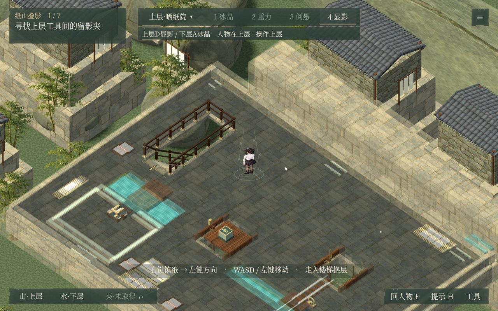
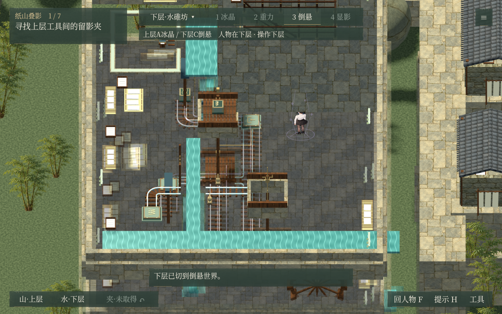

# v0.52.0 公开验收

此处保存已验收程序的汇总、各组报告、完整演示计时及画面截图。共9组621项通过：4组原生 Compatibility / ANGLE 画面检查，5组无窗口机关回归。完整演示实测87.46秒，包含归档与返回观察局。

发布副本移除一个指向未完成功能的调试入口后重新导出，通过全部9组621项检查，并校验993个源码文件。运行程序和原样冻结工程见GitHub v0.52.0 Release。工作区正在进行的两项内容不在此版本中。

