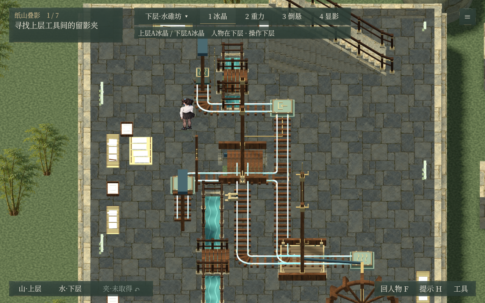
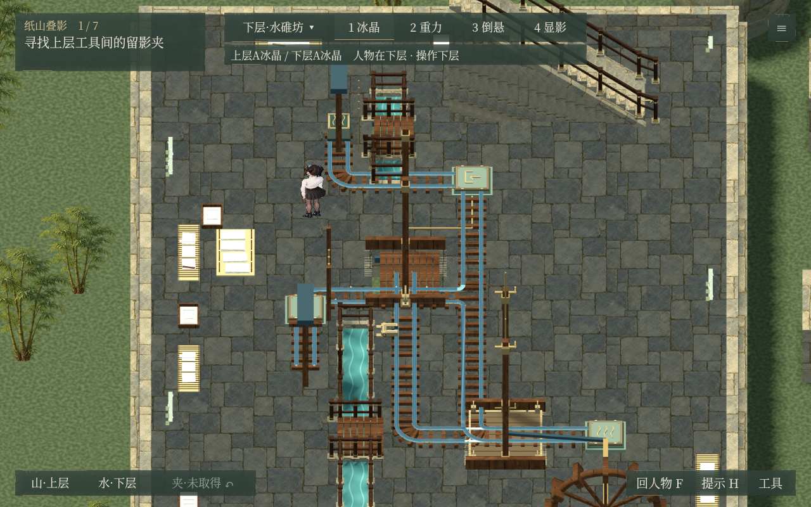
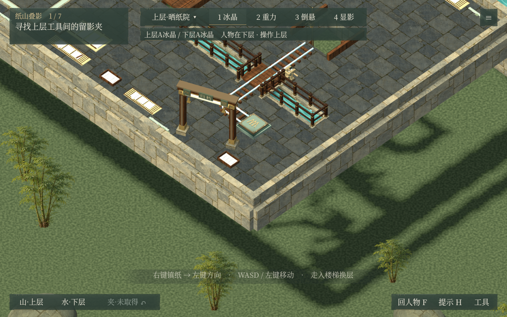
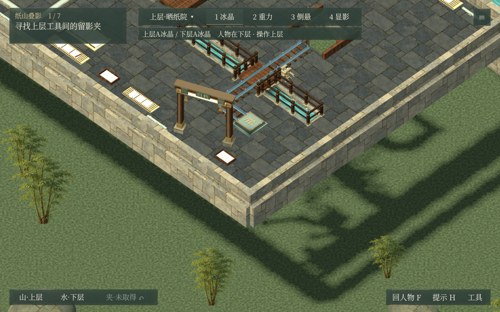

# v0.55.0 公开验收

第二关冰晶导轨沿真实双轨、圆角和分支约0.9秒结霜，短暂冰晶与冷雾后保留薄霜。上下层独立，桥面和吊台沿用真实状态。包含此前世界胶片、水岸护栏、人物提速30%、卷轴归档与倒悬实物响应。

7组470项通过：专项36、世界胶片143、圆角轨道53、倒悬42、第一关67、完整通关125、重启读档4。画面相关组在Windows原生图形程序运行，通关与读档使用隔离存档的无窗口检查。此次上传核对验收文件哈希，不改动游戏运行代码。

[试玩、完整工程、实机视频及校验值](https://github.com/forey217/nonexistent-items/releases/tag/v0.55.0)。本目录的汇总与分组报告均去除本机绝对路径，旧版发布和公开验收保留。

| 下层结霜前 | 下层薄霜完成 |
| --- | --- |
|  |  |

| 上层结霜前 | 上层薄霜完成 |
| --- | --- |
|  |  |
