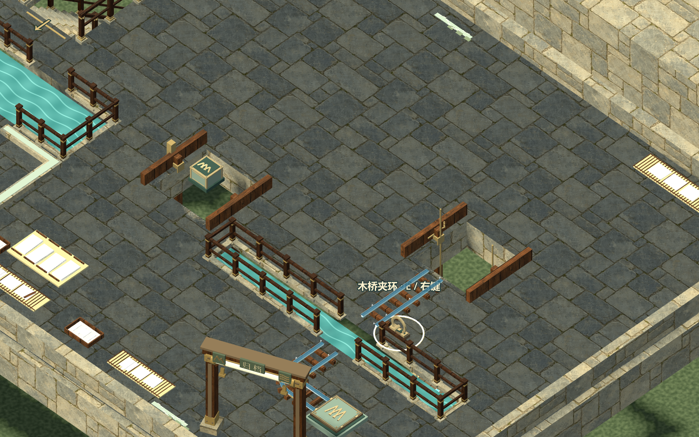
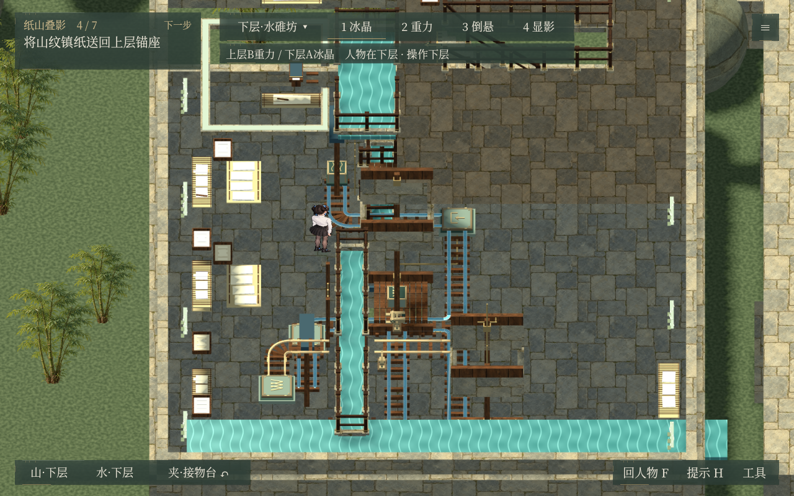

# v0.56.1 公开验收

本版把任务完成盖章、移动防闪与既有两关内容整合到同一程序。6组386项通过，详情见 [验证汇总](validation.json) 与 [各组报告](reports)。报告已去除本机绝对路径。

| 修复前 | 修复后 |
| --- | --- |
|  |  |

| 任务完成盖章 | 下一任务 |
| --- | --- |
|  |  |

[程序、完整工程与校验值](https://github.com/forey217/nonexistent-items/releases/tag/v0.56.1)。旧版发布与验收资料保留。
